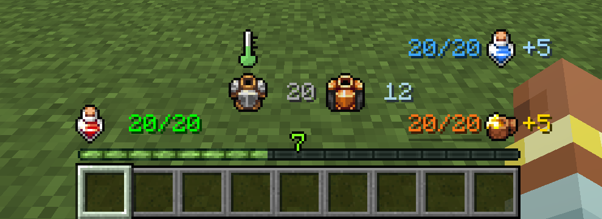
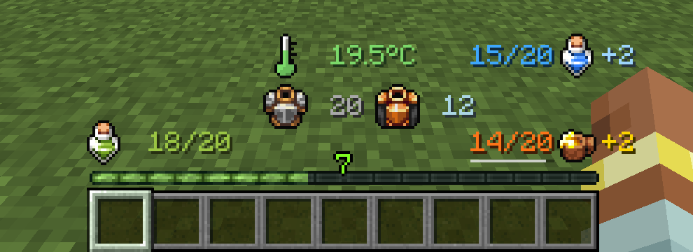
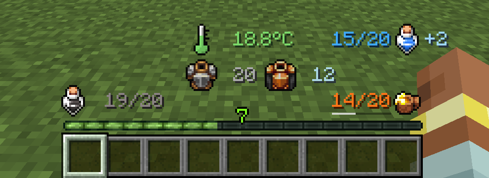
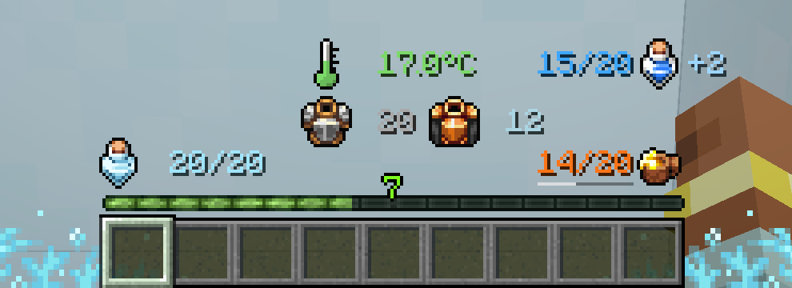
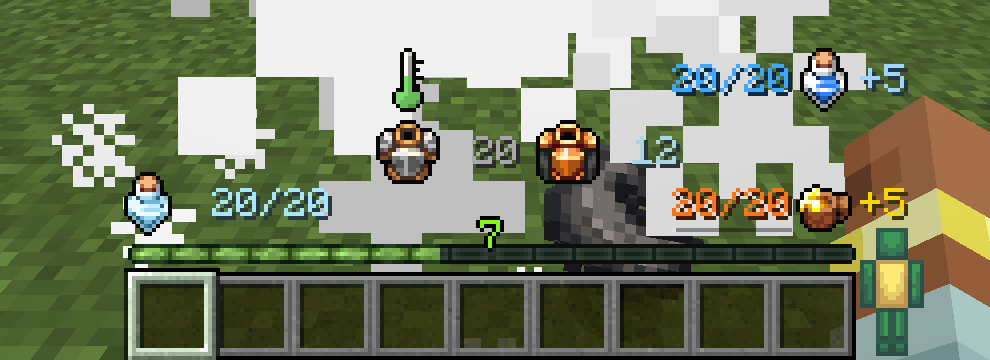
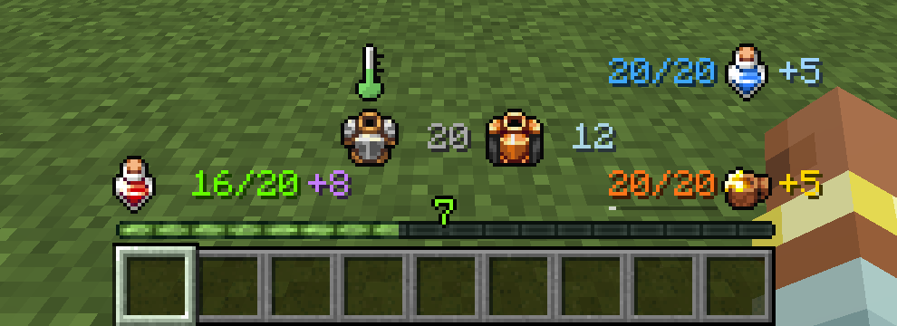
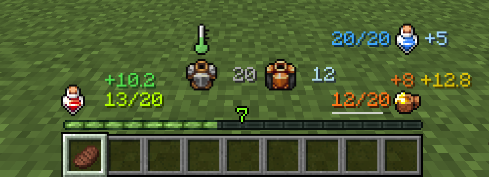
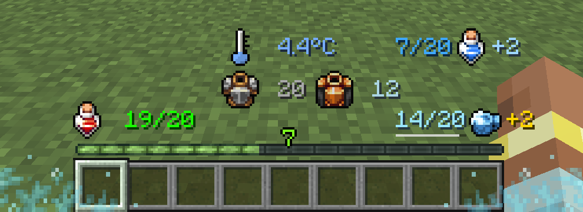
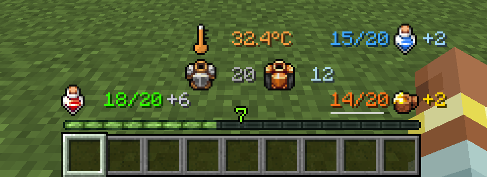

<p align="center">
  
</p>

<p align="center">
  <b>A cleaner, smarter Minecraft HUD.</b><br>
  Health, hunger, armor, toughness, oxygen and more as crisp numbers and icons, fully configurable.
</p>

<p align="center">
  <a href="https://modrinth.com/mod/betterhp"></a>
  <a href="https://www.curseforge.com/projects/1076521"></a>
  <a href="https://discord.gg/F2deya67dm"></a>
</p>

<p align="center">
  
</p>

---

## What it does

BetterHP replaces the vanilla rows of hearts, shanks, armor and bubbles with readable values, so you always know exactly where you stand. It works with **no overflow mods**: health and armor above 20 display correctly and stay in sync.

It is **client-side only**: it works on any server that allows client mods, and servers don't need it installed.

## Features

- **Numeric health**, coloured by how hurt you are (green → yellow → red), with a pulse and shake when critical. Hardcore worlds get their own icon.
- **Status icons**: the health bottle changes when you're **Poisoned**, **Withered** or **Frozen**, like vanilla's heart types.
- **Absorption** shown as `+N` after your health.
- **Armor and armor toughness**, with a little "pop" animation when they change.
- **Hunger and saturation** as numbers.
- **Oxygen** while underwater, and **mount health** while riding.
- **Fully configurable**: move every element, scale icons and text, toggle each vanilla bar back on, and change colours, in-game or in the config file.

| Poisoned | Withered | Frozen (powder snow) |
|:---:|:---:|:---:|
|  |  |  |

## Mod compatibility

Every compat is **automatic** when the other mod is installed and **optional**: BetterHP never requires them, and each one can be turned off in the config. Other mods' HUD pieces are only hidden while BetterHP is showing the same information.

### ❄️ Eidolon: Repraised

Get hit by a **Wraith** (or the Bonechill wand, frost spells, Frostbind incense) and you're **Chilled**: your health bottle **freezes over** and the number turns icy blue. Chilled also blocks healing, so now you can see it coming. **Ethereal (soul) health** shows as a purple `+N`.

| Wraith hit → Chilled | Ethereal health |
|:---:|:---:|
|  |  |

### 🍎 AppleSkin

Hold food to see a flashing preview of what it restores: **hunger**, **saturation**, and the **health** it will regenerate. A thin **exhaustion bar** sits under your hunger value. BetterHP follows AppleSkin's own settings and hides AppleSkin's bar overlays, so nothing floats over empty space.



### 🌡️ Legendary Survival Overhaul

- **Thirst** as a value with a water-bottle icon, plus thirst saturation.
- **Body temperature** as a thermometer that fills and changes colour (frostbite → cold → normal → hot → heat stroke). Equip LSO's **thermometer** to see the exact °C/°F, just like LSO.
- **Cold Hunger** turns your hunger icon to ice.
- **Shield health** and **broken hearts** shown after your health.

| Thirst, cold, thermometer equipped | Shield health, heat |
|:---:|:---:|
|  |  |

### 🔮 Iron's Spells 'n Spellbooks

**Mana** shown in the BetterHP style. Iron's own mana bar is hidden while BetterHP shows it, and the XP bar stays visible. Iron's spell bar, cast bar and recast bar are left alone.

## Versions & branches

Each Minecraft version / loader lives on its own branch.

| Minecraft | Loader | Branch | Compat available |
|---|---|---|---|
| 26.1.x | NeoForge | [`26.1-neo`](https://github.com/Bandit-bytes/betterHP/tree/26.1-neo) | AppleSkin |
| 26.1.x | Fabric | [`26.1.1-fabric`](https://github.com/Bandit-bytes/betterHP/tree/26.1.1-fabric) | AppleSkin |
| 1.21.11 | NeoForge | [`1.21.11`](https://github.com/Bandit-bytes/betterHP/tree/1.21.11) | AppleSkin |
| 1.21.11 | Fabric | [`1.21.11-fabric`](https://github.com/Bandit-bytes/betterHP/tree/1.21.11-fabric) | AppleSkin |
| 1.21.10 | NeoForge | [`1.21.10`](https://github.com/Bandit-bytes/betterHP/tree/1.21.10) | AppleSkin |
| 1.21.10 | Fabric | [`1.21.10-fabric`](https://github.com/Bandit-bytes/betterHP/tree/1.21.10-fabric) | AppleSkin |
| 1.21.1 | NeoForge | [`1.21`](https://github.com/Bandit-bytes/betterHP/tree/1.21) | AppleSkin, Eidolon: Repraised, LSO, Iron's Spells |
| 1.21.1 | Fabric | [`1.21-fabric`](https://github.com/Bandit-bytes/betterHP/tree/1.21-fabric) | AppleSkin |
| 1.20.1 | Forge | [`master`](https://github.com/Bandit-bytes/betterHP/tree/master) | AppleSkin, Eidolon: Repraised, LSO, Iron's Spells |
| 1.20.1 | Fabric | [`fabric-1.20.1`](https://github.com/Bandit-bytes/betterHP/tree/fabric-1.20.1) | AppleSkin |

Eidolon: Repraised, Legendary Survival Overhaul and Iron's Spells are only published for Forge 1.20.1 and NeoForge 1.21.1, so their compat exists on those branches.

## Installation

1. Install [NeoForge](https://neoforged.net/), [Forge](https://files.minecraftforge.net/) or [Fabric](https://fabricmc.net/) for your Minecraft version. Fabric also needs [Fabric API](https://modrinth.com/mod/fabric-api) and, for the in-game config screen, [Mod Menu](https://modrinth.com/mod/modmenu) + [Cloth Config](https://modrinth.com/mod/cloth-config).
2. Download BetterHP from [Modrinth](https://modrinth.com/mod/betterhp) or [CurseForge](https://www.curseforge.com/projects/1076521).
3. Drop the jar into your `mods` folder and launch.

## Configuration

- **NeoForge:** *Mods → BetterHP → Config*, or `config/better_hp-client.toml`
- **Forge 1.20.1:** `config/better_hp-client.toml`
- **Fabric:** *Mods → BetterHP* (Mod Menu), or `config/betterhp_config.json`

Every element has X/Y positions (X from the screen centre, Y up from the bottom). You can toggle each vanilla bar back on, or set `enableCustomHUD = false` (NeoForge) to restore the whole vanilla HUD.

## FAQ

**Does it work with other mods?** Yes. BetterHP only changes the client HUD. Mods that add their own HUD bars keep working, and the mods above get dedicated support.

**Does it affect server performance?** No. It's client-only and does nothing on a server.

**Something overlaps another mod's HUD.** Move the BetterHP element in the config, or open an [issue](https://github.com/Bandit-bytes/betterHP/issues) with a screenshot and your mod list.

## Building from source

```sh
git clone https://github.com/Bandit-bytes/betterHP.git
cd betterHP
git checkout <branch>      # see the table above
./gradlew build            # jar ends up in build/libs/
```

NeoForge 1.21.1 only: `./gradlew runClient -PwithCompatMods` starts a dev client with AppleSkin, Eidolon: Repraised and Legendary Survival Overhaul installed.

## Community

- [Pixel Dream Studios](https://discord.gg/pixel-dream-studios-872788557553610802), an official partner
- [Bandit's Discord](https://discord.gg/F2deya67dm)

<a href="https://bisecthosting.com/PixelDream"></a>

## License

All Rights Reserved © Bandit-Bytes.
